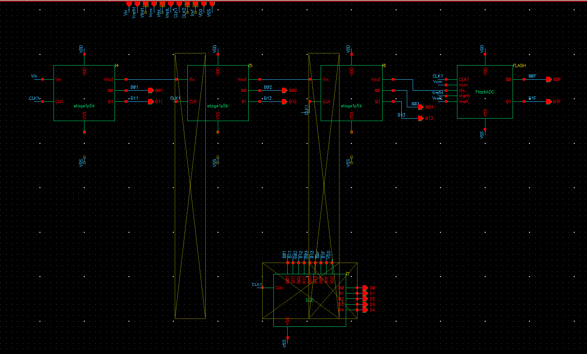
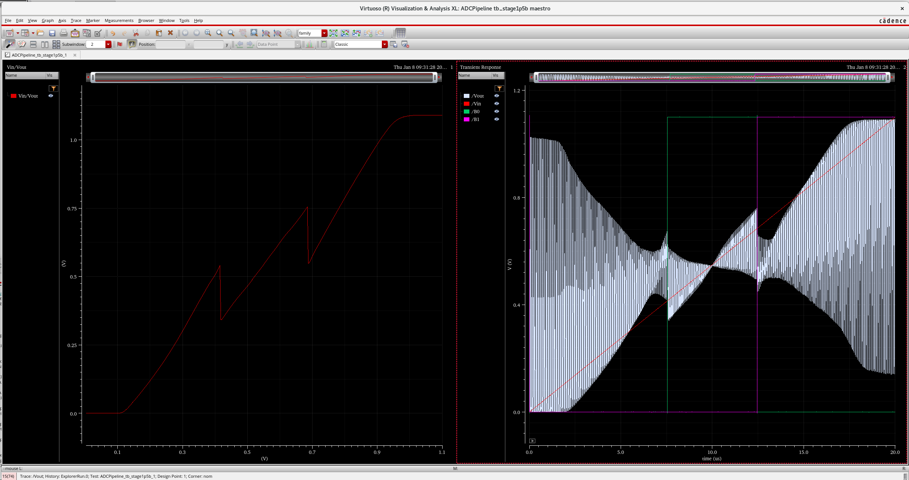
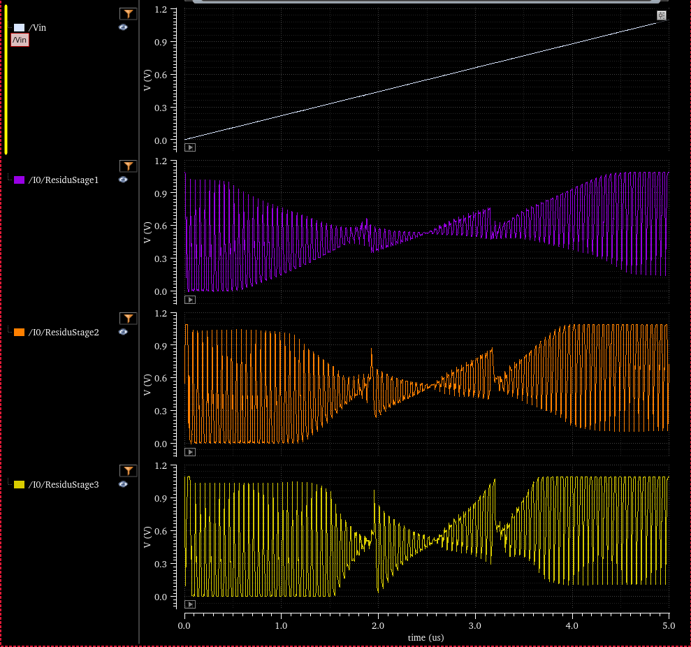
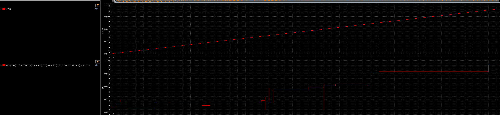

# 5-bit Pipeline ADC in 45 nm CMOS (Cadence Virtuoso)

Transistor-level design of the building blocks of a 5-bit, 1.5-bit-per-stage pipeline ADC, done as a course project for *EL4011 Analog Mixed Signal* at Institut Teknologi Bandung. Every block was designed and simulated individually, and the first 1.5-bit stage works end to end. Full-chain integration was **not** completed, and I document that plainly below.

> The designs were created on a remote lab server and could not be exported, so this repository contains the **report and simulation/schematic screenshots only** (no netlists or Virtuoso libraries).

## Specification

| Item | Value |
|---|---|
| Technology | 45 nm CMOS |
| Target resolution | 5 bit |
| Architecture | Pipeline, 1.5 bit per stage with Digital Error Correction (DEC) |
| Sampling rate (my own choice) | 20 MS/s |
| Supply | 1.1 V |
| Power | not targeted; the goal was functionality first |

## Architecture

Each stage contains a sample-and-hold, a 1.5-bit sub-ADC and a multiplying DAC (MDAC). A stage outputs the code 00, 01 or 10 (11 is never produced), and passes a residue to the next stage:

```
Vout = 2 * Vin - D * Vref
```

The redundancy of the 1.5-bit scheme tolerates comparator offset up to Vref/4, which the DEC block removes when the stage codes are recombined into the final 5-bit word. A 2-bit flash ADC terminates the chain.

## Blocks designed

| Block | Design choice |
|---|---|
| Op-amp | Two-stage Miller, NMOS differential input (W = 10 um) with PMOS current-mirror load, common-source second stage (W = 60 um), Miller compensation with nulling resistor. Chosen for near rail-to-rail output swing, which telescopic and folded-cascode topologies struggle to give. |
| Comparator | Dynamic Lewis-Gray latch (reset to VDD, then regenerative evaluation) so power is drawn only when clocked. |
| Sub-ADC | Three-zone comparator bank plus encoder driving the MDAC switches (+Vref, pass, -Vref), with a resistor-divider reference. |
| MDAC | 1.5-bit switched-capacitor stage with gain of 2 V/V. |
| Clock generator | Two-phase non-overlapping clock with dead time, so sampling and amplification never overlap. |
| Flash ADC | 2-bit flash used as the last stage. |
| DEC | Full-adder and D-flip-flop logic that aligns and sums the stage outputs into 5 bits. |

## Results

| Block | Outcome |
|---|---|
| Two-stage Miller op-amp | DC gain about 50 dB, phase margin about 60 degrees |
| Sub-ADC | Correct decisions: below 425 mV gives 00, 425 mV to 675 mV gives 01, above 675 mV gives 10 |
| 1.5-bit stage | A ramp input produces the expected sawtooth residue with 2 V/V gain; the reference divider works, with small ripple from capacitor and channel kickback |
| Dead-time clock | Both phases are low during the transition, as intended |
| 2-bit flash ADC | Codes 00, 01, 10, 11 with transitions near 445 mV, 585 mV and 760 mV |
| Top-level 5-bit ADC | **Failed.** The reconstructed output bits were noisy and non-monotonic, with oscillation in stage 2 and collapse in stage 3 |
| Layout and post-layout analysis | **Not done.** Automatic floorplanning gave about 600 DRC errors and the project deadline arrived |

### Analysis of the top-level failure

Each block passed on its own, which points to loading and drive strength rather than logic errors: the problem only appeared once stages were connected and loaded each other. The report concludes that the op-amp specification (drive capability) was insufficient for the integrated chain, so errors accumulated stage after stage. It also recommends replacing the resistive reference block with a bandgap reference followed by a buffer op-amp, to fix reference-voltage stability. The next steps would be to strengthen the op-amp output stage, re-verify with all stages loaded together, and only then proceed to layout.

## Gallery

Top-level schematic (three 1.5-bit stages, a 2-bit flash ADC and the DEC block):



Simulation of the 1.5-bit stage (sawtooth residue):



Top-level simulation, residues of stages 1 to 3 under a ramp input. The clean sawtooth of the stand-alone stage degrades from stage to stage:



Top-level simulation, reconstructed digital output (should be a monotonic 32-step staircase, but is not):



More images are in `images/schematics/` (op-amp, comparator, sub-ADC, MDAC, clock, DEC, flash, bias) and `images/simulation/`.

## Files

| Path | Content |
|---|---|
| `docs/Laporan_Akhir_ADC_Pipeline.pdf` | Final report, IEEE format (in Indonesian) |
| `docs/top_level_block_diagram.drawio` | Editable top-level block diagram |
| `images/schematics/` | Schematic screenshots of each block |
| `images/simulation/` | Simulation waveform screenshots |

## Reference

R. J. Baker, *CMOS Circuit Design, Layout, and Simulation*, 4th ed., IEEE Press / Wiley, 2019.
B. Sahoo, "Pipelined ADC Design: A Tutorial," presentation slides, University of Illinois at Urbana-Champaign.
